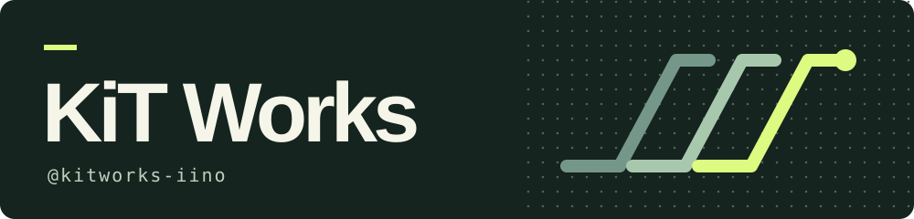

会議が終わったら議事録ができている。空き時間にスマホで一問解ける。そんな、仕事と暮らしの中で自分が使いたい道具を作っています。

## 公開プロジェクト

### [Giji AutoMemo ↗](https://github.com/kitworks-iino/giji-automemo)
Teams会議を録音し、発言を話者ごとに文字に起こして、日本語の議事録にまとめるWindowsアプリです。

### [Gtest ↗](https://kitworks-iino.github.io/Gtest-Quiz/)
G検定の問題をスマホで一問ずつ。解説を読んだ後、間違えた問題だけを選んで復習できます。 [ソースコード](https://github.com/kitworks-iino/Gtest-Quiz)

### [ヒキヨミ ↗](https://github.com/kitworks-iino/hikiyomi)
LINEで1日1回引けるスロット占い。生年月日を登録したら、あとはワンタップで今日の運勢を占えます。
